<p align="center"></p>

# PiVista

**Turn any HDMI monitor into a smart TV with a Raspberry Pi 4. Your phone is the remote.**

- 📺 10-foot TV interface (1080p) with an animated raspberry opening screen
- 🌍 **English and Türkçe**: Settings → Language switches the TV, every paired phone and the games
- ▶️ YouTube (TV layout), Netflix, HBO Max and Disney+ via their official web players (Widevine DRM), each zoomed to suit a TV
- 🚫 Optional **YouTube ad blocker** (off by default, so YouTube Premium is never affected)
- 📱 Phone remote at **http://pivista.local**: pair by scanning the dot pattern on the TV. No app to install, no mouse, no keyboard.
  - **Screen tab:** see the TV screen on your phone and tap to press things. Video is never streamed, so the Pi stays fast.
  - **Keyboard pops up on the phone** when a text field gets focus on the TV
  - **Direct-IP fallback** when `.local` (mDNS) doesn't work on your phone or network
- 🧩 **Install your own apps:** any website or PWA by address, a single `.html` file, or a `.zip` web app
- 🎬 Media Player (mpv, hardware decode): local files, USB drives and stream links, with **4K output** for 4K files, plus now-playing controls on the phone
- 🌐 Web Browser with bookmarks, history, and back/forward/reload and an address bar on the phone
- 🎮 **Games**: Raspberry Rally (kart racer), Berry Snake, Brick Blaster, Berry Merge, with a hold-to-steer game mode on the phone
- ⚙️ System apps: Settings, System Info (temperature, throttling, power), Pair Remote, Add App
- 🔊 Sound through **HDMI** (the TV's speakers) by default, or switch to the **audio jack** or **USB speakers** in Settings
- 📶 **Wi‑Fi**, 🕒 **date & time / time zone**, resolution, device name, 24-hour clock and more in Settings
- 🔒 **Screen lock** from the first paired phone: pauses video and games, covers the screen and blocks all remotes until unlocked
- 🔁 After a **network change** (new Wi‑Fi or new IP), the TV shows the pairing screen again
- 🚀 Starts on boot (you can turn that off in Settings)
- 🌡️ Overheat protection, SD-card-friendly tuning, HDMI tuned to work every time

## Screenshots

| | |
|---|---|
| 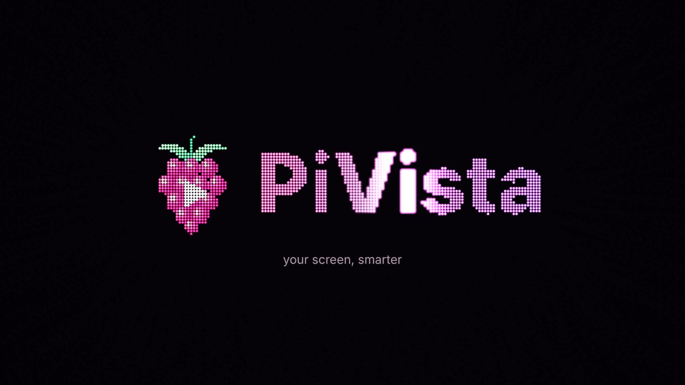 Opening animation | 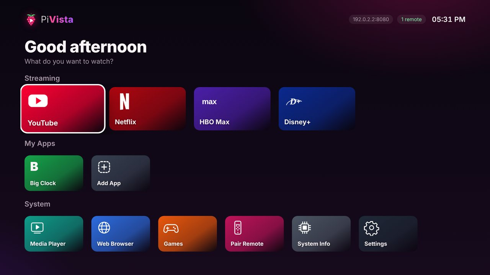 Home screen |
| 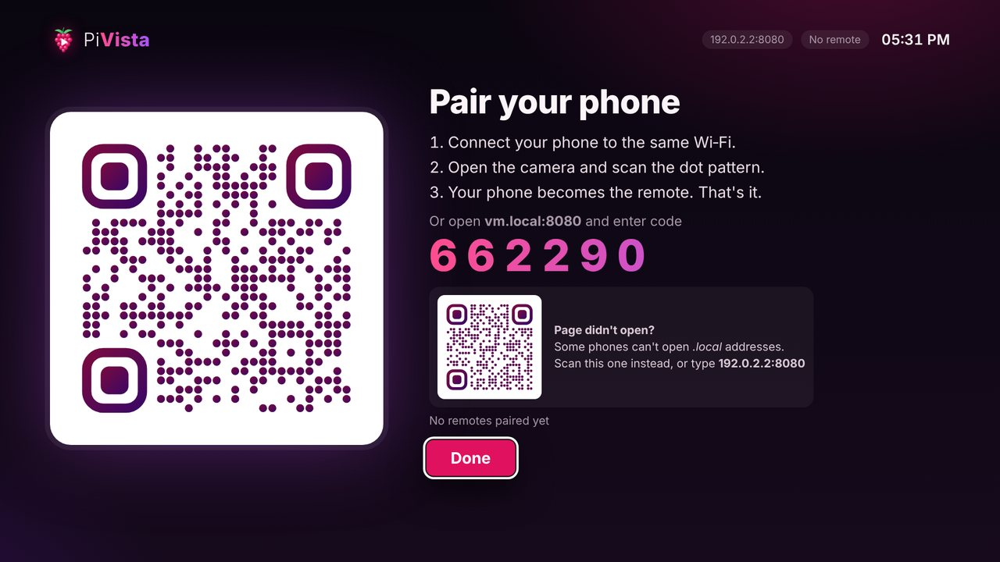 Pairing (dot pattern + direct-IP fallback) | 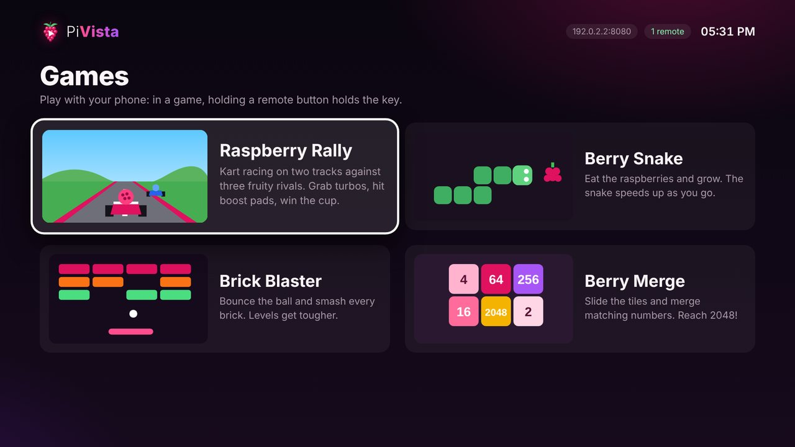 Games |
| 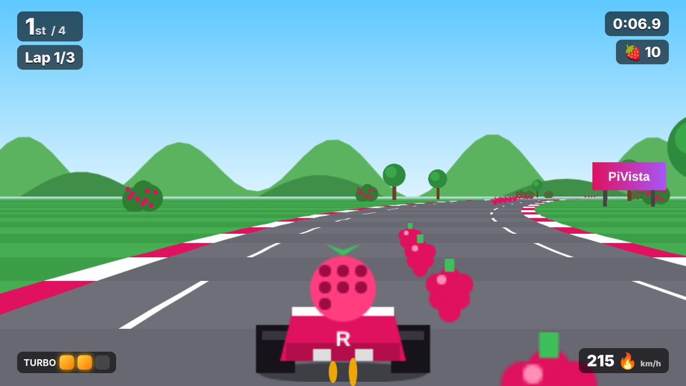 Raspberry Rally | 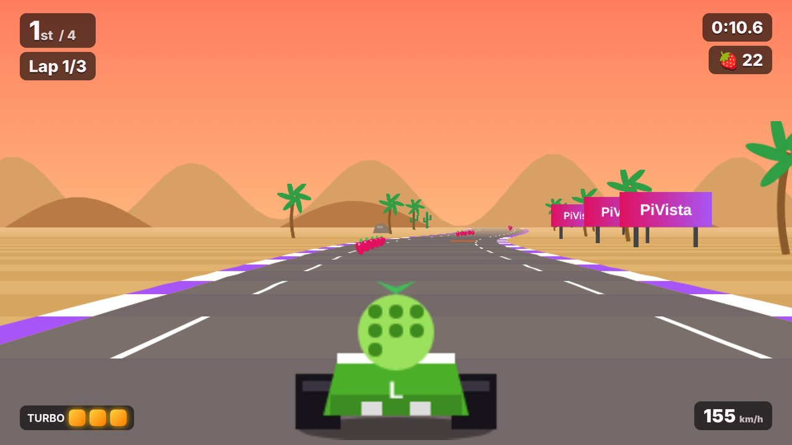 Raspberry Rally: Sunset Dunes |
| 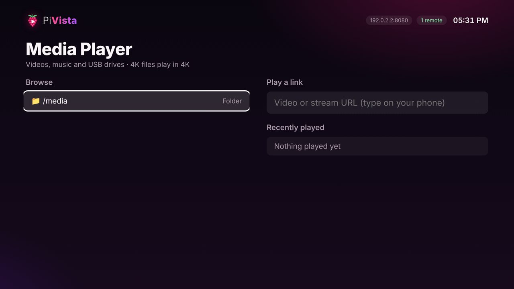 Media Player | 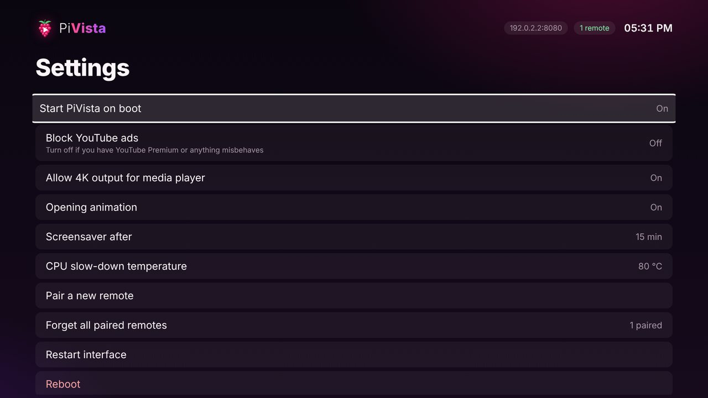 Settings |

| Phone remote | | | |
|---|---|---|---|
| 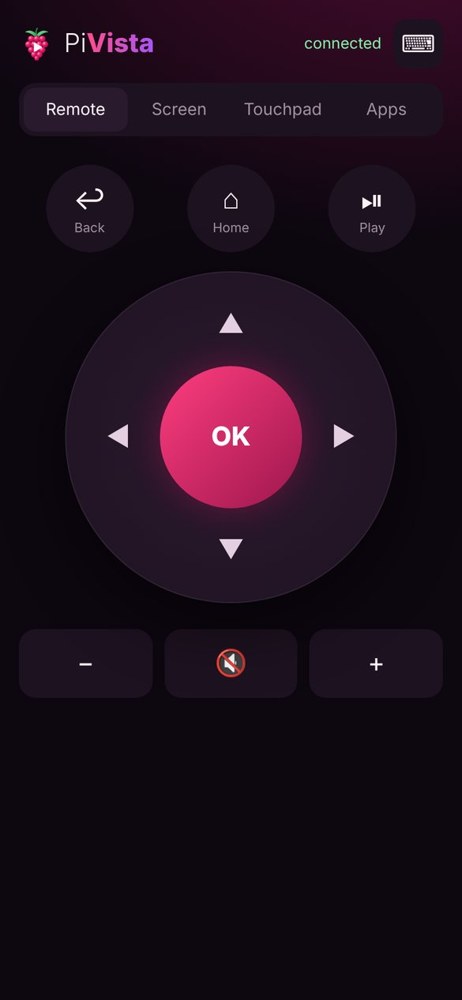 | 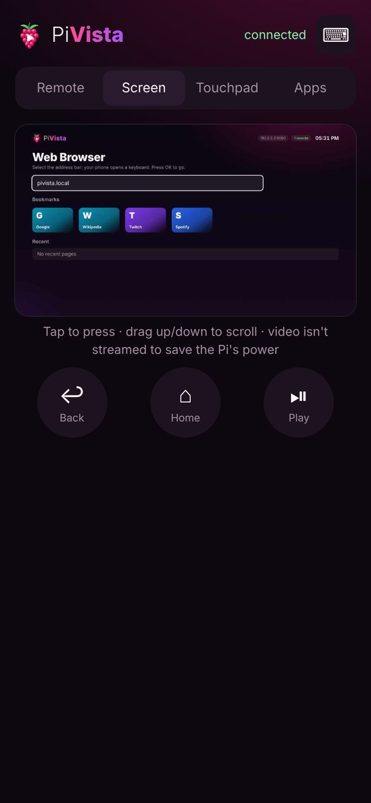 | 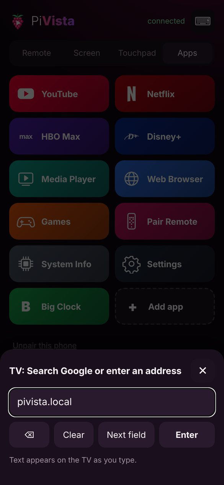 | 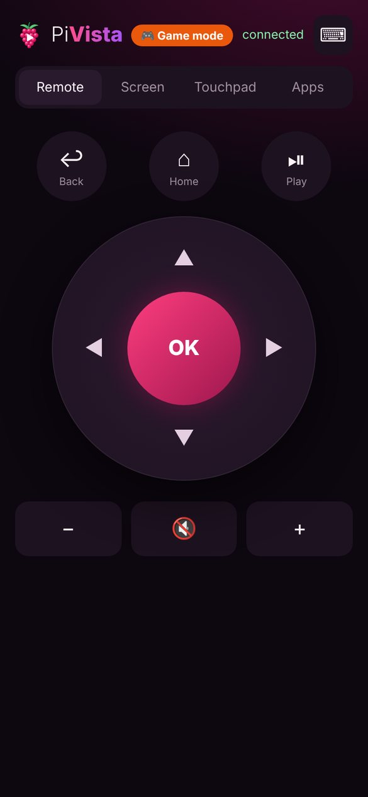 |
| Remote | Screen mirror | Pop-up keyboard | Game mode |

More in [`docs/screenshots`](docs/screenshots).

## Games

**Games** on the home screen has four built-in games, all original and all playable with the phone remote. In a game, the remote switches to **🎮 Game mode**: holding a button on the phone holds the key on the TV, so you can steer.

| Game | What it is | Controls |
|---|---|---|
| **Raspberry Rally** | Pseudo-3D kart racer: 4 fruit drivers with different handling, 2 tracks (Berry Valley, Sunset Dunes), 3 laps against AI rivals, boost pads, berry pickups (small top-speed bonus) and turbo item boxes | Auto-accelerates · ◀ ▶ steer · ▼ brake · OK turbo |
| **Berry Snake** | Classic snake that speeds up as it grows | Arrows |
| **Brick Blaster** | Paddle-and-ball brick breaker with levels | Hold ◀ ▶ · OK launch |
| **Berry Merge** | Slide-and-merge number puzzle (reach 2048) | Arrows · ⏯ restart |

Back always returns to the Games list, and best scores are saved on the Pi.

**Smooth on a Pi:** the games draw with WebGL through a small batch renderer (`ui/games/render.js`). Every road strip, sprite and rectangle of a frame goes into one buffer and is drawn in a single GPU call from one texture atlas. If only software WebGL is available (e.g. Chromium in safe mode), they switch to Canvas 2D automatically. Screen mirroring to the phone pauses while a game runs, and the game logic uses a fixed timestep, so speed doesn't depend on frame rate.

---

## Requirements

| | |
|---|---|
| Board | Raspberry Pi 4 (2 GB works, 4 GB recommended) |
| OS | **Raspberry Pi OS 64-bit (Bookworm or newer)**, Lite or Desktop |
| Power | Official 5V/3A USB-C supply. Under-voltage causes stutter, and PiVista warns you about it. |
| Cooling | A heatsink at least. A case fan is better for long 4K sessions. |
| Network | Phone and Pi on the same Wi-Fi/LAN |

## Install

> **Branch:** all PiVista code is on the **`claude/kind-mccarthy-xql5k2`** branch (it's also the repository's default branch). There is no `main` branch, so every command below names the branch explicitly.

1. Flash **Raspberry Pi OS (64-bit)** with Raspberry Pi Imager. In the Imager settings, set Wi-Fi, a user and SSH.
2. Boot the Pi and SSH in (or use a keyboard just this once).
3. Run:

```bash
curl -fsSL https://raw.githubusercontent.com/pyrz-tr/PiVista/claude/kind-mccarthy-xql5k2/scripts/install.sh | sudo bash
```

4. Reboot:

```bash
sudo reboot
```

On first boot you'll see the PiVista intro and then the **Pair your phone** screen. Open your phone camera, scan the dot pattern, and you're in.

The installer downloads the branch above. To install from a different branch, pass `PIVISTA_BRANCH` after `sudo`, so the variable reaches the script:

```bash
curl -fsSL https://raw.githubusercontent.com/pyrz-tr/PiVista/<branch>/scripts/install.sh | sudo PIVISTA_BRANCH=<branch> bash
```

### Other ways to install

**From a checkout:**

```bash
git clone -b claude/kind-mccarthy-xql5k2 https://github.com/pyrz-tr/PiVista.git && cd PiVista && sudo ./scripts/install.sh
```

**From the .deb:** every push to `claude/kind-mccarthy-xql5k2` builds an installable package. Open the repository's **Actions** tab, select the latest **Build & package** run on that branch, and download the **pivista-deb** artifact (a zip containing the `.deb`). GitHub Releases are created only when a version tag such as `v0.3.0` is pushed. Then on the Pi:

```bash
unzip pivista-deb.zip
```

```bash
sudo apt install ./pivista_0.3.0_all.deb
```

Installer options: `--keep-hostname` (don't rename the Pi to `pivista`), `--no-tuning` (skip system tuning).

## Using it

| Phone remote | What it does |
|---|---|
| D-pad / OK | Move and select (hold an arrow to repeat) |
| Back | Go back (inside YouTube too). At the top level of an app, returns Home |
| Home | Back to the PiVista home screen from anywhere |
| Play | Play/pause |
| − 🔇 + | HDMI volume |
| ⌨ (top right) | Opens the phone keyboard. It **opens by itself** when a text field gets focus on the TV. What you type replaces the TV field's text live. Enter submits, and "Next field" works like Tab. |
| Screen tab | Live view of the TV (about 6 fps, low-res JPEG). Tap to press, drag to scroll. Mirroring pauses while a video plays or the media player is open, to save the Pi's CPU and RAM. |
| Touchpad tab | Mouse pointer for sites that need it (e.g. signing in to Netflix): drag to move, tap to click, two fingers to scroll |
| Apps tab | Jump straight to any app, or **+ Add app** |
| Now-playing bar | Appears while the media player runs: seek, pause, ±10 s, subtitles, audio track, stop |
| Browser bar | Appears in the web browser: back, forward, reload, address bar, ☆ bookmark |

Tip: in the phone browser use **Add to Home Screen**, and the remote opens full screen like an app.

### Screen lock

The **first phone that was paired** is the owner and gets a 🔒 button at the top of the remote. Pressing it:

- pauses any playing video (Netflix, YouTube, the media player…) and freezes games,
- covers the TV with a "Screen locked" message,
- blocks every phone's remote (including the owner's) until the owner presses **Unlock**.

Other phones see "Screen locked" and can't unlock it. If the owner phone is lost, run `sudo pivista unlock` on the Pi. Removing all paired remotes also unlocks the TV.

### Exit to desktop

Settings → System → **Exit to desktop** (asks for confirmation first, with Cancel selected by default) closes PiVista and shows the normal Raspberry Pi desktop. On Raspberry Pi OS Lite, the login console appears instead. The phone remote shows "PiVista is closed". The **first paired phone** gets an **Open PiVista** button that brings the TV screen back. From a terminal: `sudo pivista tv`. Rebooting starts PiVista as usual.

### Settings

| Section | Settings |
|---|---|
| General | Language (English/Türkçe), device name, start on boot, opening animation, screensaver |
| Sound | Output (HDMI / audio jack / USB speakers / Bluetooth, whatever is connected), volume |
| Display | Screen resolution (1080p, 720p, monitor default), 4K for the media player, 24-hour clock |
| Network & time | Wi‑Fi (scan, connect; password typed on the phone), date & time, automatic time, time zone search |
| Apps | YouTube ad blocker |
| Remotes | Pair a new remote, forget all remotes |
| System | CPU slow-down temperature, update PiVista, GitHub access token (private repo), exit to desktop, restart, reboot, shut down |

**Sound:** PiVista prefers HDMI, so the sound comes out of the TV or monitor. If your monitor has no speakers, plug headphones or speakers into the 3.5 mm jack, or plug in USB speakers, then choose them in **Settings → Sound output**. The choice is remembered.

**Network change:** when the Pi joins a different Wi‑Fi or gets a new IP address, the TV opens the pairing screen with the new address and dot pattern so phones can connect again.

### When `pivista.local` doesn't open (mDNS fallback)

Some phones and routers can't resolve `.local` names (older Android versions, guest Wi-Fi, some mesh systems). PiVista always gives you a direct route:

- The TV shows its **IP address** in the top bar on every screen.
- The pairing screen has a second, smaller **"direct" dot pattern** that encodes `http://<ip>/#pair=…`.
- An already paired phone remembers the Pi's IP. If `.local` stops responding, the remote offers **"Use direct IP"** and moves your pairing over automatically.

Tip: give the Pi a fixed IP (DHCP reservation in your router) so the direct address never changes.

## YouTube ad blocker

**Settings → Block YouTube ads** (off by default). When it's on, PiVista injects a small script into YouTube that removes ad entries from YouTube's player data, blocks ad and tracking hosts, and automatically skips any ad that still gets through.

YouTube changes often, so this is best-effort. If you have **YouTube Premium**, or anything acts strangely, just turn it off: nothing is injected into YouTube while it's off.

## Installing your own apps

Open **Add App** on the TV, or **Apps → + Add app** on the phone:

| Format | How | Notes |
|---|---|---|
| Website / PWA | Enter its address (e.g. `music.youtube.com`) | PiVista reads the site's web app manifest for the name, icon, colour and start page |
| Single HTML file | Upload a `.html` from your phone | Good for dashboards, clocks, games |
| Web app bundle | Upload a `.zip` with `index.html` at the root (or in one top folder) | An optional `manifest.json` sets the name and icon |

Pick a TV zoom (100/125/150%) so the app is readable from the couch. Installed apps appear in **My Apps** on the home screen. Remove them from the same screens.
Uploaded apps run from `http://localhost/userapps/…`, a separate browser origin from the TV interface, so an app can't control PiVista.

## Updating

**From the TV:** Settings → System → **Update PiVista** shows whether a new version is available. Press OK and confirm. PiVista downloads the newest version through the GitHub API, installs it, and restarts by itself (about 1–3 minutes).

**Private repository:** updates keep working if the repository is made private. Create a fine-grained GitHub token (GitHub → Settings → Developer settings → Fine-grained tokens, access to this repository only, permission **Contents: Read-only**). Enter it on the TV in Settings → System → **GitHub access token**; your phone's keyboard opens for it. The token is stored only on the Pi (`/var/lib/pivista/github-token`, readable by root only) and is never sent to phones. Or save it from the terminal:

```bash
echo 'github_pat_…' | sudo tee /var/lib/pivista/github-token >/dev/null && sudo chmod 600 /var/lib/pivista/github-token
```

Versions before 0.6.0 update through the public download link, so update to 0.6.0 or later **before** making the repository private. For a first install from a private repository, clone it with your token and run the installer from the checkout:

```bash
git clone -b claude/kind-mccarthy-xql5k2 https://<token>@github.com/pyrz-tr/PiVista.git && cd PiVista && sudo ./scripts/install.sh
```

**Other ways:**

Run `sudo pivista update` (0.3.1 and later), or run the same install command again. It replaces the app in `/opt/pivista`, keeps your settings, paired phones and installed apps (`/var/lib/pivista`), and restarts the server:

```bash
curl -fsSL https://raw.githubusercontent.com/pyrz-tr/PiVista/claude/kind-mccarthy-xql5k2/scripts/install.sh | sudo bash
```

From a checkout instead:

```bash
cd PiVista && git pull origin claude/kind-mccarthy-xql5k2 && sudo ./scripts/install.sh
```

Then restart the TV interface (or reboot):

```bash
pivista restart
```

## Troubleshooting

### Black screen on the monitor, but `http://pivista.local` opens

The server is fine; the screen part (`pivista-kiosk.service`: cage + Chromium) isn't starting.

**Most common cause (fixed in 0.3.1):** with no keyboard or mouse plugged in, which is normal for PiVista, the cage compositor refused to start (`libinput initialization failed, no input devices`). Update PiVista to get the fix. Over SSH:

```bash
curl -fsSL https://raw.githubusercontent.com/pyrz-tr/PiVista/claude/kind-mccarthy-xql5k2/scripts/install.sh | sudo bash -s -- --keep-hostname
```

The installer restarts the screen right away, with no reboot needed. On 0.3.1 and later you can update with `sudo pivista update`.

**Still black?** Run the built-in checkup. It checks the services, Chromium, the HDMI connection, groups and boot config, prints the last log lines, and saves everything to `/tmp/pivista-doctor.txt`:

```bash
sudo pivista doctor
```

Common findings:

| Doctor says | Fix |
|---|---|
| Kiosk log repeats `status=203/EXEC`, or `user pivista cannot open /opt/pivista` | Folder permissions (fixed in 0.3.2): `sudo chmod 755 /opt/pivista && sudo chmod -R a+rX /opt/pivista && sudo pivista restart` |
| `pivista-kiosk is inactive (enabled: disabled)` | Autostart was turned off: `sudo pivista enable && sudo pivista restart` |
| `lightdm … is running` | The desktop login is taking the screen: `sudo systemctl disable --now lightdm && sudo pivista restart` |
| `no monitor detected` | Use the HDMI port **next to the USB-C power port**, check the cable and the monitor's input, then `sudo pivista restart` |
| `chromium missing` | `sudo apt install chromium-browser` (on newer OS versions: `chromium`) |
| Netflix/Max/Disney+ only fill part of the screen (white area) | Fixed in 0.4.0: update. The kiosk loads the zoom extension, so run `sudo pivista restart` after updating |
| Log shows `Chromium crashed … safe mode` | A GPU driver problem: PiVista falls back to software rendering automatically. To force it, add `PIVISTA_CHROMIUM_FLAGS="--disable-gpu"` to `/etc/default/pivista`, then `sudo pivista restart` |

The screen adapts to whatever resolution the monitor accepts (1080p is preferred; 720p and 4K screens are scaled to fit).

### Command line

```bash
pivista status     # service status
pivista logs       # follow logs
pivista restart    # restart server + TV interface
pivista disable    # don't start on boot (server + remote keep running)
pivista enable     # start on boot again
pivista doctor     # diagnose a black screen / problems, saves /tmp/pivista-doctor.txt
pivista update     # download and install the latest version (GitHub API; uses the saved token if any)
pivista desktop    # close PiVista and show the desktop / console
pivista tv         # bring the PiVista TV screen back
pivista unlock     # unlock the TV if the owner phone is lost
pivista uninstall  # remove services and boot tweaks (keeps /opt/pivista and your settings)
```

To also delete the app and all settings, paired phones and installed apps:

```bash
sudo /opt/pivista/scripts/uninstall.sh --purge
```

---

## How it works

```
                 ┌──────────────── Raspberry Pi 4 ───────────────────┐
  Phone ── Wi-Fi ─▶  pivista.service (Node.js, :80)                    │
  http://pivista.local   • serves phone remote  /                      │
  (WebSocket)            • serves TV interface  /tv/                   │
                         • pairing (dot pattern = styled QR code)      │
                         • thermal guard, volume, HDMI mode, power     │
                         • screen mirror, games, installed apps        │
                         │  Chrome DevTools Protocol (localhost:9222)  │
                         ▼                                             │
                pivista-kiosk.service: cage (Wayland kiosk) ─▶ Chromium full screen ─▶ HDMI
                                                 └─▶ mpv (native 4K player)
```

- **Stack:** Node.js (2 small dependencies: `ws` and `qrcode`) and plain HTML/CSS/JS. Nothing to compile, so it's easy to hack on.
- **Display:** [cage](https://github.com/cage-kiosk/cage) is a minimal Wayland compositor that runs one app full screen. No desktop runs in the background, which leaves more RAM and GPU for video.
- **Remote input:** the server injects key presses, text and pointer events straight into Chromium over the DevTools Protocol. That works the same on PiVista's own UI and on Netflix/YouTube, with no fake input devices.
- **Correct sizing per app:** each app gets real browser zoom (like pressing Ctrl and + in Chrome), so the page re-lays itself out and fills the whole screen with TV-sized text. A tiny built-in Chromium extension (`system/zoom-extension`) asks the server (`/api/zoom`) for the right zoom on every page load. Netflix, Max and Disney+ use 150%, the browser uses 125%, and YouTube's TV layout uses 100% because it's already built for TVs.
- **Streaming apps:** each one opens its official web player with a suitable user agent. YouTube gets the TV ("Leanback") layout, built for D-pad navigation. Netflix, Max and Disney+ get a Chrome OS user agent, which unlocks Widevine HD. Change these in `server/apps.js`.
- **Pairing:** the TV shows a one-time 6-digit code as a dot pattern (a QR code drawn with round dots) pointing to `http://pivista.local/#pair=CODE`. The phone trades the code for a long-lived device token. Only the TV itself can read the pattern endpoint. Codes rotate every 5 minutes and work only once.

### Video resolution: the honest version

- **UI: always 1920×1080@60.** It's forced in `cmdline.txt` (`video=HDMI-A-1:1920x1080@60D`) and again by `kiosk.sh` via `wlr-randr`, even on 4K screens. The Pi 4 GPU can't drive a smooth 4K browser UI.
- **Native player: up to 4K.** When a file is taller than 1080p and *Settings → Allow 4K output* is on, PiVista switches HDMI to 3840×2160@30, plays with hardware HEVC decoding, and switches back to 1080p when you exit. For 4K@60, uncomment `hdmi_enable_4kp60=1` in `/boot/firmware/config.txt` (it adds heat).
- **Streaming sites:** these are limited by the service, not by PiVista. DRM'd browser playback on Linux/ARM usually tops out at 720p–1080p, and the Pi 4 has no hardware VP9/AV1 decoder, so YouTube runs best at 1080p or lower.

### HDMI reliability

- `hdmi_force_hotplug=1` and the `D` flag on the kernel `video=` mode keep HDMI driven even if the monitor is off or slow to wake at boot.
- `disable_overscan=1` removes black borders. The UI renders 1:1 at 1920×1080 (`--force-device-scale-factor=1`).
- `cma-512` on the KMS overlay reserves enough contiguous memory for 4K decode buffers.
- Use the HDMI port **next to the USB-C power port** (HDMI0). The script detects whichever port is connected.

### Performance tuning (applied by the installer)

- No desktop environment, just cage + Chromium. GPU rasterization and zero-copy are on, and Chromium's cache lives in RAM (`/dev/shm`).
- zram swap (zstd) replaces SD-card swap. Logs stay in RAM (32 MB cap), the root filesystem uses `noatime`, and unneeded services (cups, ModemManager, triggerhappy, packagekit) are off.
- Wi-Fi power saving is off, which avoids stream stutter. The CPU uses the `ondemand` governor with a quicker ramp-up.
- The server gets a 300 MB memory cap.

### Overheat protection

1. **Firmware:** `temp_limit=82` (default 85 °C).
2. **PiVista thermal guard** (`server/thermal.js`) checks the SoC temperature every 30 s (every 10 s once it's within 5 °C of the limit). At the limit set in Settings (default 80 °C) it caps the CPU at 1.2 GHz, and at limit + 5 °C at 1.0 GHz. It restores full speed below limit − 10 °C and shows a notice on screen (including on top of Netflix/YouTube).
3. **Under-voltage detection** through `vcgencmd get_throttled`, with an on-screen warning.
4. Optional lines in `config.txt` for a GPIO fan (`dtoverlay=gpio-fan`) and to drop the 1.8 GHz boost (`arm_boost=0`) on passively cooled boards.

---

## Development

Work happens on the `claude/kind-mccarthy-xql5k2` branch:

```bash
git clone -b claude/kind-mccarthy-xql5k2 https://github.com/pyrz-tr/PiVista.git && cd PiVista
```


Then run it on any computer (the Chromium-control features simply don't do anything without a kiosk browser):

```bash
npm install
npm run dev
```

Then open the TV interface at http://localhost:8080/tv/ (use the arrow keys, Enter and Esc) and the remote at http://localhost:8080/.

To test remote control end to end on a desktop, start Chromium with `--remote-debugging-port=9222` and open the TV URL in it.

```
server/   Node.js server: index.js (HTTP/WS + routing, mirror), cdp.js (browser control), pairing.js,
          player.js (mpv), system.js (hardware), thermal.js, apps.js (app catalog), config.js,
          adblock.js (YouTube ad blocker), userapps.js (installed apps)
ui/shared logo + app icons
ui/games  built-in games (common.js: input/loop helpers, render.js: WebGL batch renderer; one HTML file per game)
ui/shared logo, app icons, i18n.js (English/Türkçe)
system/zoom-extension  Chromium extension applying per-app TV zoom
ui/tv/    TV interface (splash, spatial navigation, system apps)
ui/remote Phone remote (PWA)
system/   systemd units, kiosk launcher (start-kiosk.sh → cage → kiosk.sh → Chromium), doctor, boot config, CLI
scripts/  install / uninstall / CI self-test
packaging Debian package build
```

**Adding an app:** add an entry to `server/apps.js` with `url`, optional `userAgent`, `color`, `icon`, and `back: 'key'` (the site handles Esc itself) or `'history'`.

## CI / packaging

`.github/workflows/build.yml` runs on every push (any branch, including `claude/kind-mccarthy-xql5k2`) and on pull requests. It runs the self-test, syntax-checks the shell scripts, builds `pivista_<version>_all.deb` (architecture-independent, with `node_modules` bundled) and uploads it as an artifact. Pushing a tag like `v0.3.0` also publishes a GitHub Release with the `.deb`.

## Known limitations (v0.6)

- Streaming services can change their web apps or block unusual user agents at any time. If one breaks, try a different user agent in `server/apps.js`.
- Netflix/Max/Disney+ web players are made for mouse use. Use the D-pad where it works and the touchpad tab for the rest.
- No HDMI-CEC (TV remote) support yet.
- The phone keyboard pops up for real text fields. YouTube's TV layout uses its own on-screen keyboard, so use the D-pad there or open YouTube search in the browser.
- iOS won't let a web page open the keyboard by itself: the keyboard sheet appears, and you tap the field once.

## Changelog

See [CHANGELOG.md](CHANGELOG.md).

## License

MIT
